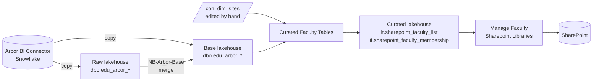

# Arbor faculty tables

The [Curated Faculty Tables](Curated%20Faculty%20Tables.Notebook/notebook-content.py) notebook builds the two tables that the [Manage Faculty Sharepoint Libraries](../Manage%20Faculty%20Sharepoint%20Libraries.Notebook/notebook-content.py) notebook reads: the faculty list (`it.sharepoint_faculty_list`) and each faculty's current members (`it.sharepoint_faculty_membership`). It builds them from Arbor MIS tables and a site table that gives each academy's SharePoint hub site.

This page says where each table the notebook reads comes from in Archway Learning Trust's Fabric workspace, from Arbor's BI Connector to the lakehouse. Use it to find out why a faculty or a member is missing, or to set up the same tables elsewhere.

- [How the data flows](#how-the-data-flows)
- [Tables the notebook reads](#tables-the-notebook-reads)
- [How membership is worked out](#how-membership-is-worked-out)
- [The site table](#the-site-table)
- [Why the notebook checks its source](#why-the-notebook-checks-its-source)
- [Tables the notebook writes](#tables-the-notebook-writes)
- [Running it elsewhere](#running-it-elsewhere)

## How the data flows

1. **Arbor to raw or base.** The `DP-Arbor-Ingest-Metadata-Driven` pipeline copies every Arbor table listed in the ingest metadata table, `dbo.arbor_ingest_metadata` in the base lakehouse, that has `refresh_frequency = 1`. Each row gives the Snowflake query, the lakehouse to copy into (its `layer`, `RAW` or `BASE`), the table, and whether a column mapping is applied. Each copy overwrites `dbo.<destination_table>`. The rows' `destination_schema` of `edu` isn't used yet, as the Education tables haven't moved out of `dbo`.
2. **Raw to base.** The `NB-Arbor-Base` notebook reads each raw table, casts its columns, and merges it into the base table of the same name on its unique ID. The merge updates changed rows, inserts new ones and deletes rows that are no longer in raw, so each base table matches the latest extract.
3. **Base to curated.** The Curated Faculty Tables notebook joins the base tables with `con_dim_sites` and writes the two IT tables.

The `DP-Arbor-Main` pipeline runs steps 1 and 2, then the Education curated notebooks. `DP-Arbor-Ingest-Incl-API` runs the same two steps before the Arbor API notebooks. The `NB-IT-ManageSharepointLibraries` pipeline runs step 3 and then, if it succeeds, the Manage Faculty Sharepoint Libraries notebook.

Nothing links the Arbor pipelines to the SharePoint one, and their schedules are set in Fabric rather than in source control. Schedule the SharePoint pipeline to start after `DP-Arbor-Main` has finished, or it works from the previous extract.

The ingest metadata rows are defined in the `NB-Arbor-Ingest-Metadata-Table-Update-1` to `-6` notebooks, which the `DP-Arbor-Update-Metadata-Table` pipeline runs in order. The rows for staff and the membership and link tables are in `-1`, faculties and departments are in `-6`, and business role assignments are in `-2`. Each row's `ingest_data_id` is given below, to find it.

## Tables the notebook reads

The Arbor tables are in the BI Connector's `ARBOR_MIS_ENGLAND_MODELLED` schema. Every table except `con_dim_sites` is in the base lakehouse.

| Table | Arbor table | How it's loaded | Columns the notebook uses |
| --- | --- | --- | --- |
| `dbo.edu_arbor_staff` | `STAFF` | Copied to raw (ingest ID 37, mapped), then merged into base on `staff_unique_id`, adding `has_active_roles` | `staff_unique_id`, `legal_first_name`, `legal_last_name`, `email`, `has_active_roles` |
| `dbo.edu_arbor_staff_faculty_memberships` | `STAFF_FACULTY_MEMBERSHIPS` | Copied to raw (ingest ID 95), then merged into base on `staff_faculty_membership_unique_id` | `faculty_unique_id`, `staff_unique_id`, `is_active`, `end_date` |
| `dbo.edu_arbor_staff_department_memberships` | `STAFF_DEPARTMENT_MEMBERSHIPS` | Copied straight to base (ingest ID 39, mapped), replacing the table each run. `NB-Arbor-Base` doesn't touch it | `department_unique_id`, `staff_unique_id`, `is_active`, `end_date` |
| `dbo.edu_arbor_faculty_departments` | `FACULTY_DEPARTMENTS` | Copied to raw (ingest ID 96), then merged into base on `faculty_department_unique_id` | `faculty_unique_id`, `department_unique_id`, `start_date`, `end_date` |
| `dbo.edu_arbor_faculties` | `FACULTIES` | Copied to raw (ingest ID 51, mapped), then merged into base on `faculty_unique_id`, replacing Arbor's faculty code with one made from the name | `faculty_unique_id`, `application_id`, `faculty_name`, `faculty_code`, `is_active` |
| `dbo.edu_arbor_departments` | `DEPARTMENTS` | Copied to raw (ingest ID 62, mapped), then merged into base on `department_unique_id` | `department_unique_id`, `application_id` |
| `dbo.con_dim_sites`, in the curated lakehouse | None | Edited by hand, see [The site table](#the-site-table) | `arbor_application_id`, `academy_code`, `sharepoint_hub_url` |

Two columns are made on the way to base, and both change what the SharePoint notebook does:

- **`has_active_roles`** on staff is 1 when the staff member has at least one business role assignment that has a start date and hasn't ended (no end date, or an end date of today or later), and 0 otherwise. The assignments come from Arbor's `BUSINESS_ROLE_ASSIGNMENTS`, copied straight to base as `dbo.edu_arbor_business_role_assignments` (ingest ID 24, mapped). The notebook only counts staff with active roles, so a leaver drops out of every library even if their faculty or department membership is still open in Arbor. The `NB-Arbor-IT-Outputs-Base` notebook, in the `DP-Arbor-IT-outputs` pipeline, also merges base staff, with the same query.
- **`faculty_code`** on faculties isn't Arbor's `FACULTY_CODE`. `NB-Arbor-Base` makes it from the faculty's name: each run of characters that aren't letters or digits becomes `_`, a `_` at either end is removed, and the result is upper case, so "Science & Maths" becomes `SCIENCE_MATHS`. Renaming a faculty in Arbor changes its code in base. The faculty list keeps the code it first saw in `static_faculty_code`, which the library's URL and group names are made from, and only updates `current_faculty_name`. A rename therefore changes the library's display name, not its URL or groups.

## How membership is worked out

A member of a faculty is a staff member with an active role (`has_active_roles = 1`) who has either:

- an active (`is_active`) membership of the faculty that hasn't ended, or
- an active membership of a department that hasn't ended, where the department is linked to the faculty today: the link in `edu_arbor_faculty_departments` has started (or has no start date) and hasn't ended.

A membership hasn't ended when it has no end date, or an end date of today or later. The member's address is their Arbor `email`, and someone who qualifies both ways is listed once. Faculties that aren't active in Arbor are left out, so the faculty list soft deletes them and the SharePoint notebook unlinks their libraries.

## The site table

`con_dim_sites` is the trust's site dimension, one row per site, in the curated lakehouse. Nothing loads it from Arbor: it's edited by hand with `UPDATE` and `INSERT` statements. The notebook joins it on `arbor_application_id`, the ID of the academy's Arbor site (`application_id` on every Arbor table), to get the academy's code and its hub site (`sharepoint_hub_url`, such as `https://<tenant>.sharepoint.com/sites/<academy code>StaffHub`). It uses the department's application ID, or the faculty's for a faculty with no department linked to it today.

- **A new academy.** Add its row with `arbor_application_id`, `academy_code` and `sharepoint_hub_url`. Until then its faculties are in the faculty list without an academy code or hub, and the SharePoint notebook skips them. The first run after the row is added fills both in and stamps `last_changed_ts`, so the libraries are created then.
- **A new hub site.** Changing an academy's `sharepoint_hub_url` moves its libraries. The faculty list records the old URL in `previous_hub_url`, and the SharePoint notebook creates each library on the new hub, then retires the old one.
- **One row per application ID.** Two rows with the same `arbor_application_id` would list each of its faculties twice. The notebook stops before its merge, with "duplicated faculty_unique_id", rather than pick one.

## Why the notebook checks its source

Each copy replaces its table, and each base merge deletes rows that are no longer in raw. If Arbor returned no rows, or only some, the base tables would shrink to match in the same run. The faculty list would then soft delete the missing faculties, and the SharePoint notebook would empty their groups.

So before its merge the notebook stops if its source has no faculties while the faculty list has live ones, if it has fewer than `SOURCE_MIN_ROW_FRACTION` (80% by default) of them, or if it lists a faculty twice. If a genuine change removes more than that, lower the parameter for one run. A copy that fails leaves its table as it was, and `DP-Arbor-Main` only runs `NB-Arbor-Base` when every copy has succeeded.

## Tables the notebook writes

Both are in the curated lakehouse.

- **`it.sharepoint_faculty_list`** has one row per Arbor faculty. It's kept with a merge, so it remembers each faculty's first code, earlier name and earlier hub, and soft deletes (`deleted_in_source`) faculties that leave Arbor rather than removing their rows. `last_changed_ts` is when the row last changed in a way the SharePoint notebook acts on. `exclude_from_sharepoint` and the three `all_staff_*` columns are set by hand, and the merge never changes them. When setting `exclude_from_sharepoint` by hand, also set `last_changed_ts` to the current time, or the SharePoint notebook won't see the change.
- **`it.sharepoint_faculty_membership`** has one row per member of each faculty, and is replaced each run. A faculty with no members has no rows.

The notebook's comments describe each column and each clause of the merge.

## Running it elsewhere

The notebook only needs the six Arbor tables with the columns above, however they're loaded, and a site table that maps each Arbor application ID to an academy code and a hub site URL. Change the names in its tables cell to match. Like the SharePoint notebook, it reads the workspace and lakehouse names from a variable library called `VL_CORE` (`STORE_WORKSPACE_NAME`, `BASE_LH_NAME` and `CURATED_LH_NAME`).

The Education and site tables are still in `dbo` under their domain prefix. When they move to the `edu` and `con` schemas, change the names in the tables cell, so `dbo.edu_arbor_staff` becomes `edu.arbor_staff` and `dbo.con_dim_sites` becomes `con.dim_sites`.
